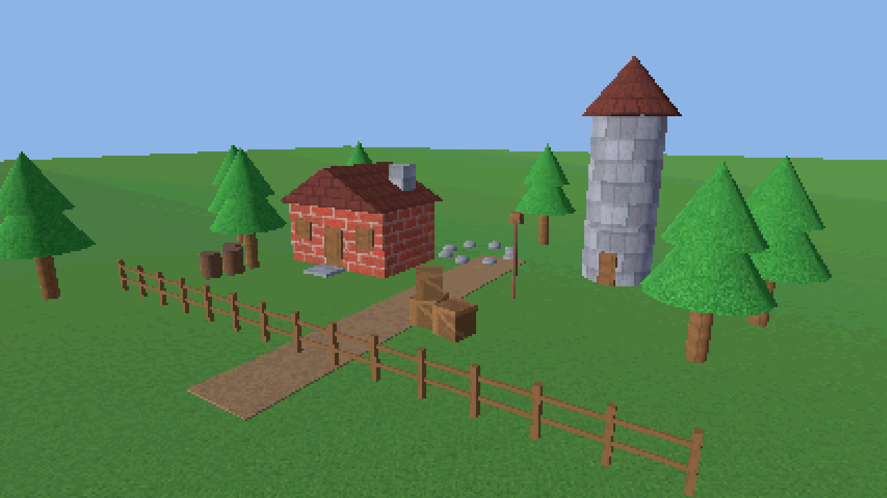
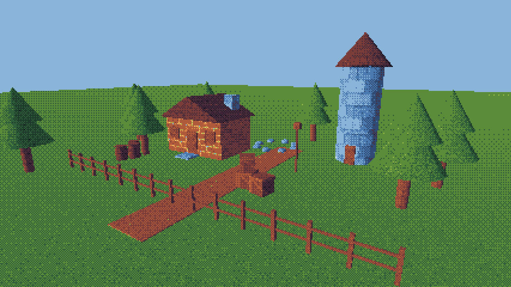
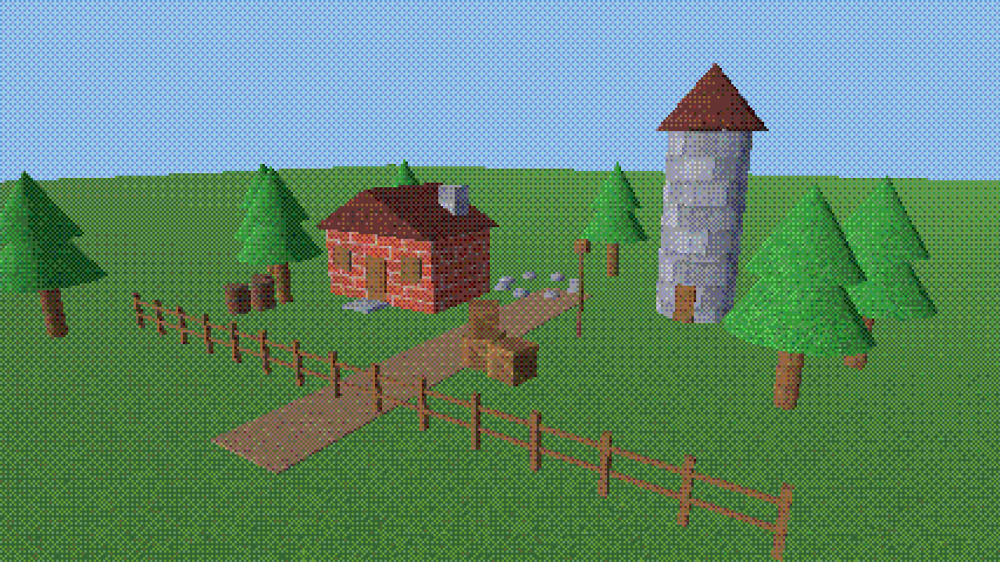
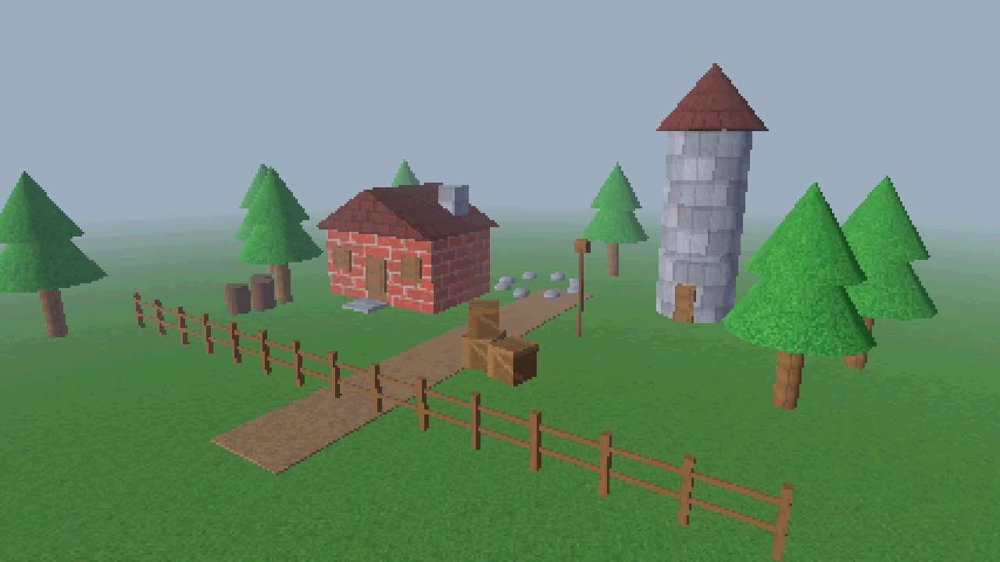
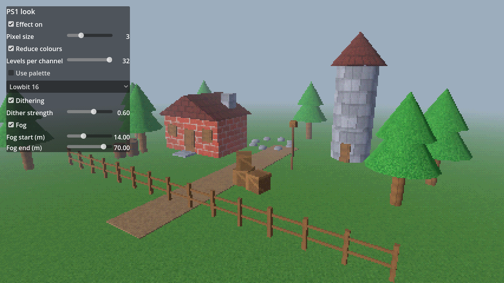

# Lowbit PS1 Look



A PS1-style look for Godot 4 3D scenes, **without any geometric distortion**.

The add-on lowers the internal resolution, reduces the colours (optionally to a palette), applies ordered dithering and can add depth fog. Geometry and textures are rendered by the engine as usual, only the finished image is reduced, so nothing wobbles when the camera moves: **no vertex snapping, no affine texture warping, no jitter**.

- Low internal resolution at a whole-number scale, nearest-neighbour filtering
- Colour reduction: levels per channel, or a palette (three ready-made, or your own)
- Ordered dithering, 4x4 Bayer matrix, on/off and strength
- Optional depth fog
- One node to drop in (or one autoload), a settings resource, exported properties in the inspector
- GDScript and one canvas shader, no other dependencies
- MIT licence

| Off | On | Palette |
|---|---|---|
|  |  |  |

| Dithering | Fog | Settings panel |
|---|---|---|
|  |  |  |

## Requirements

Godot 4.3 or newer. Developed and tested on Godot 4.3 and 4.7.2, with the Compatibility renderer and with Forward+ (see [Tested](#tested) for what that does and does not cover).

## Installation

**From the Asset Library:** open the AssetLib tab in the editor, search for "Lowbit PS1 Look", download and install. An Asset Library entry is filed for one Godot version, so the tab of a much newer editor may not list it: in that case use the manual install below or download the repository.

**By hand:** copy the folder `addons/lowbit_ps1_look` into your project's `addons` folder.

Enabling the plugin (Project > Project Settings > Plugins) is optional. The node works without it; enabling it adds Project > Tools > "Lowbit PS1 Look: add to open scene".

## Usage

1. Open the scene that contains your 3D world and your `Camera3D`.
2. Add a node of type `LowbitPS1Look` (Create Node dialog, or the Tools menu entry).
3. In the inspector, create a `LowbitPS1Settings` in the `Settings` property (or leave it empty to use the defaults) and adjust the values.
4. Run the scene.

From code:

```gdscript
var look := LowbitPS1Look.add_to(self)          # adds a node with default settings
look.settings.pixel_size = 4                     # 320x180 in a 1280x720 window
look.settings.use_palette = true
look.settings.palette_preset = LowbitPS1Settings.PalettePreset.WARM_8
look.enabled = false                             # back to the normal image
```

**As an autoload:** add `res://addons/lowbit_ps1_look/lowbit_ps1_look.gd` in Project > Project Settings > Globals. It finds the current `Camera3D` on its own, also one that appears later.

**Settings panel:** `LowbitPS1Panel` is a ready-made control that edits the settings live. Add it to your UI and call `panel.bind(look)`. The demo scene shows it.

## Settings

All properties are on `LowbitPS1Settings` unless noted.

| Property | Default | What it does |
|---|---|---|
| `LowbitPS1Look.enabled` | on | Turns the effect on or off at runtime. |
| `resolution_mode` | `PIXEL_SIZE` | `PIXEL_SIZE`: the internal size follows the window. `FIXED`: a fixed internal size, shown at the largest whole-number scale that fits, with black bars. |
| `pixel_size` | 3 | Window pixels per low-resolution pixel (1 to 16). 3 gives 427x240 in a 1280x720 window. |
| `fixed_size` | 320x240 | Internal size in `FIXED` mode. |
| `reduce_colors` | on | Colour reduction by levels. |
| `color_levels` | 32 | Levels per colour channel (2 to 256). 32 is 15-bit colour, 256 is no reduction. |
| `use_palette` | off | Use a palette instead of levels. |
| `palette_preset` | `LOWBIT_16` | `LOWBIT_16`, `WARM_8`, `GREEN_4` or `CUSTOM`. Choosing one fills `palette`. |
| `palette` | 16 colours | Your own colours, at most 64 are used. Editing it switches the preset to `CUSTOM`. |
| `dither_enabled` | on | Ordered dithering (4x4 Bayer), locked to the low-resolution grid. |
| `dither_strength` | 0.6 | 0 to 1. At 1 the pattern spreads over one colour step. |
| `fog_enabled` | off | Depth fog. |
| `fog_color` | grey-blue | Fog colour. |
| `fog_start` / `fog_end` | 6 m / 30 m | Distances where the fog starts and where it is solid. |
| `fog_match_background` | on | With fog on, a plain-colour or clear-colour background takes the fog colour so distant things fade into it. |

In palette mode the dither amplitude is at most about a fifth of the colour range (scaled by `dither_strength`) and `color_levels` does not apply. The settings panel limits the levels slider to 32.

`LowbitPS1Look` also has `get_internal_size()`, `get_pixel_scale()` and `refresh()` (call it after you swap the `Environment` of your camera at runtime).

## How it works, and what to know

- While enabled, the node renders the world a second time into a small `SubViewport`, with a mirror of your current `Camera3D` (transform, projection, `Environment`, cull mask, camera attributes copied just before each frame is drawn). The main viewport stops rendering 3D (`Viewport.disable_3d`), so the scene is not drawn twice.
- Your 2D nodes and UI are drawn on top, at full resolution. The node sits on canvas layer -1; change `layer` if you need another order.
- Use the default stretch mode (Project Settings > Display > Window > Stretch > Mode = `disabled`) so that one low-resolution pixel covers a whole number of screen pixels. With a scaling stretch mode the scale is whole in the scaled coordinates, not in real screen pixels.
- With fog on, the node works on a private copy of your `Environment`. Yours is never modified.
- One 3D camera is mirrored. Split-screen with several 3D viewports is not covered. Camera compositor effects and doppler settings are not copied.
- Screen-to-world helpers of your camera (`unproject_position`, `project_ray_origin`) still use the full-window view. They match the picture in `PIXEL_SIZE` mode except for the last row and column of low-resolution pixels, which are cropped when the window size is not a multiple of `pixel_size`. In `FIXED` mode with black bars the picture is smaller than the window, so convert mouse positions yourself.
- With 3D physics interpolation (Godot 4.4+) the mirror uses the camera's interpolated transform, like the main camera. This path is not covered by the tests.
- Several `LowbitPS1Look` nodes on one viewport (an autoload and a scene node) are allowed; they share the viewport and the last one to leave restores it.
- Dithering is anchored to the screen grid, as on the original hardware. It does not move with objects.

## Tested

- Godot 4.3 (Compatibility, Forward+) and 4.7.2 (Compatibility, Forward+), Linux, software OpenGL and software Vulkan (llvmpipe, lavapipe). All 12 checks pass on each of the four combinations.
- Checks in the `tests/` folder of the repository, which is not part of the Asset Library download (run `bash tests/run_tests.sh /path/to/godot`, Forward+ with `DRIVER=vulkan METHOD=forward_plus`): static scan of the add-on for forbidden tokens (vertex code, texture-coordinate writes, snapping, affine, jitter); effect off versus pixel size 1 gives an identical image, both with a still camera and with the camera moving every frame (this catches a lagging or snapped camera); a still camera gives identical frames one second apart with every effect on; a vertical edge follows the true projection within one low-resolution pixel while the camera glides; the look adds no noise compared with the plain image while the camera moves; whole-number scale in both resolution modes and after resizing the window; palette and level limits; a node that starts disabled shows the normal view; two nodes share the viewport; toggling and removing the node restores the 3D viewport.
- Not proven by the checks: that the low-resolution picture matches a downsample of the full-resolution picture (the low-resolution render uses a coarser texture level), and the physics-interpolation path.
- Not tested: a real GPU, Windows, macOS, Web, mobile devices, the Mobile renderer, XR.

## Demo

Open this repository as a project and run `demo/demo.tscn`. The scene is a small yard of primitive meshes with textures drawn in code, so it ships no third-party art. Keys: Space = effect on/off, P = palette, D = dithering, F = fog, Tab = settings panel.

## Licence

MIT, see [LICENSE](LICENSE). Copyright (c) 2026 Lowbit Lab.
